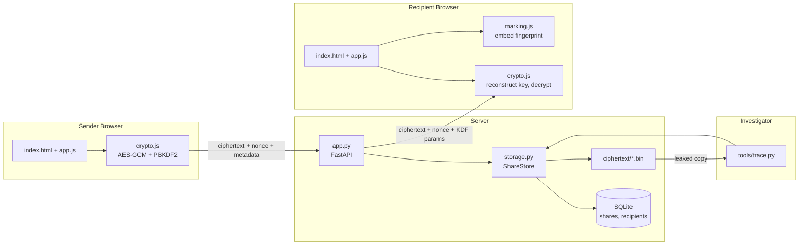

# CipherShare — Architecture

*The design and threat model of CipherShare: end-to-end encrypted, leak-traceable
file sharing with expiring links.*

`TRACING.md` explains the leak-tracing method in depth. This document stays at the
concept level; implementation detail lives in the code, and measured results live
in `report/evidence/`.

## 1. What the system claims

- **Private.** Files are encrypted with AES-256-GCM in the browser with a fresh
  key and nonce per file. The server stores only ciphertext and metadata; no key
  is ever uploaded.
- **Protected.** For password-protected shares the file key is split: one half
  travels in the URL fragment, the other is derived from the password
  (PBKDF2-HMAC-SHA-256, 600,000 iterations). A leaked link alone decrypts nothing.
- **Accountable.** Each recipient gets a registered 128-bit token; the recipient's
  browser embeds a fingerprint derived from that token into every download, and
  `tools/trace.py` attributes a leaked copy to the registered link it came from.
- **Expiring.** Expiry and revocation are enforced server-side on every download:
  404 unknown, 410 expired or revoked.

Two boundaries stated up front: an **unprotected share's complete link is a bearer
credential** — whoever holds it can decrypt before expiry — and **client-side
marking is deterrence, not enforcement**: a modified client can download unmarked
(§8).

## 2. Tech stack

| Layer | Technology |
|---|---|
| Backend | Python 3.13, FastAPI 0.124, Uvicorn 0.48 |
| Storage | SQLite (stdlib) + flat ciphertext files on disk |
| Frontend | Plain HTML/CSS/JS (ES modules), no frameworks, no external assets |
| Browser crypto | Web Crypto API (`crypto.subtle`) |
| Tracer | Python CLI, Pillow for image decoding |
| Testing | pytest 9 (API + tracer), Node `node:test` (crypto + marking, sharing the browser modules directly) |

No third-party code runs in the browser. All cryptography is delegated to the Web
Crypto API; nothing custom is invented for encryption or hashing of secrets.

## 3. Repository layout

```
ciphershare/
├── app.py                FastAPI application (endpoints, validation, headers)
├── storage.py            ShareStore: SQLite + ciphertext file management
├── requirements.txt      pinned Python dependencies
├── ARCHITECTURE.md       this document
├── TRACING.md            leak-tracing method explainer
├── static/               index.html, app.js, crypto.js, marking.js, style.css
├── tools/                trace.py, fingerprint_mirror.py, evaluate.py, benchmark.py
├── tests/                pytest + Node suites, cross-language fingerprint vector
└── data/                 runtime state (gitignored)
report/evidence/          recorded evidence 01–21 supporting the report claims
```

## 4. Components



Responsibilities are strictly separated: `app.py` is the HTTP boundary (no crypto,
no SQL); `storage.py` is persistence (no HTTP); `crypto.js` holds primitives only;
`marking.js` implements the fingerprint scheme and is shared verbatim with the
Node tests; `app.js` orchestrates the UI; `tools/*` do offline investigation
through the same `ShareStore`.

## 5. Cryptographic design

### 5.1 File encryption

- Fresh **AES-256-GCM** key and fresh 96-bit nonce per file, generated with the
  Web Crypto API; a 128-bit authentication tag is appended to the ciphertext.
- Ciphertext and nonce are uploaded; the key is not. Plaintext never reaches the
  server.

### 5.2 Password-split keys

```
K  = random 256-bit file key (never stored or transmitted whole)
P  = human-chosen share password
salt  = random 128-bit value (stored server-side, public parameter)
W  = PBKDF2-HMAC-SHA-256(P, salt, 600_000 iterations, 256 bits)   # password half
R  = K XOR W                                                      # link half
```

- The upload carries only `salt` and the iteration count; the URL fragment carries
  only `R`. Fragments are never sent in HTTP requests, so the server sees no key
  half.
- The recipient re-derives `W` from the password, reconstructs `K = R XOR W`, and
  decrypts locally. A wrong password fails the GCM tag check — no extra protocol.
- A leaked link yields `R` only; an attacker must brute-force `P` through 600k
  PBKDF2 iterations per guess. A PAKE (OPAQUE, RFC 9380) would remove the
  offline-guessing path entirely — future work.

### 5.3 Leak tracing (summary)

- One 128-bit token per (share, recipient), generated server-side with
  `secrets.token_urlsafe(16)` and `UNIQUE`-indexed; tokens travel only in the URL
  fragment and are stored only in the recipient registry.
- After decrypting, the recipient's browser derives a 512-bit codeword from the
  token via HMAC-SHA-256 and embeds it into 1536 image pixels' least significant
  bits (non-image files get an appended `%%CS2:<token>%%` trailer).
- The tracer extracts the mark and scores it against every registered token,
  accusing only above a calibrated threshold.
- Full construction, math, attack table, and limitations: `TRACING.md`.
- A pre-token label-based scheme remains readable via `tools/trace.py --legacy`
  for old evidence only; it is scheduled for removal.

## 6. Data model

```sql
CREATE TABLE shares (
    share_id          TEXT PRIMARY KEY,   -- 192-bit urlsafe token
    ciphertext_path   TEXT NOT NULL,
    nonce_b64         TEXT NOT NULL,
    original_filename TEXT NOT NULL,
    mime_type         TEXT NOT NULL,
    created_at        INTEGER NOT NULL,
    expires_at        INTEGER NOT NULL,   -- server-decided
    revoked           INTEGER NOT NULL DEFAULT 0,
    salt_b64          TEXT,               -- NULL = plain share
    kdf_iterations    INTEGER
);

CREATE TABLE recipients (
    share_id     TEXT NOT NULL,
    display_name TEXT NOT NULL,
    created_at   INTEGER NOT NULL,
    token        TEXT                      -- 128-bit marking credential
);

CREATE UNIQUE INDEX recipients_token ON recipients (token);
```

No file-encryption key material is stored anywhere. Ciphertext files are created
exclusively and unlinked if the DB insert fails, so a crash cannot leave
half-registered shares.

## 7. API surface

- `GET /health` → status/version.
- `POST /shares` (multipart) → validates nonce, salt/iteration pairing and bounds,
  payload size (10 MiB max), lifetime (1 s–24 h, server-decided), and recipient
  names; stores ciphertext; returns `share_id`, `expires_at`, and one
  personal link token per recipient (`201`).
- `GET /shares/{id}` → ciphertext plus `X-Nonce`, `X-Filename`, `X-Salt`,
  `X-Kdf-Iterations` headers; `404` unknown, `410` expired/revoked, `413` too
  large, `400` malformed input.
- `GET /` and `GET /s/{id}` serve the single-page app; the path selects the
  sender or recipient flow.

## 8. Security boundary

> **Client-side marking is deterrence, not enforcement.** A recipient who patches
> the JavaScript, or downloads without a valid marking identity, obtains content
> untraceable by this fingerprinting mechanism. The fingerprint attributes a copy
> to a registered link; it does not prove who created or leaked it, and a stolen
> token can be used to frame its owner.

**Protects against:**

- Server-disk or database compromise → file contents stay encrypted; a dump alone
  contains no key material and no link half.
- Link leakage → for password-protected shares, the link alone cannot decrypt.
- Ciphertext tampering → AES-GCM tag failure.
- Guessing share IDs (192-bit) → infeasible.
- Expired/revoked links → rejected server-side on every download.
- Post-download leaks → statistical attribution to a registered recipient link
  (reliability is empirical; see `TRACING.md` and evidence 13).

**Does not protect against:**

- A malicious server replacing the frontend JavaScript — the ceiling on all
  client-side claims (signed/reproducible builds: future work).
- Unprotected links circulating: they are bearer credentials.
- Offline dictionary attacks on weak passwords by a link holder.
- Recipients re-sharing plaintext after decryption (attribution, not prevention).
- JPEG re-encoding, cropping, screenshots — the mark is destroyed.
- Coalitions larger than the tuned 2–3 colluders.
- Traffic analysis, DoS, public-internet hardening.

## 9. Testing

| Suite | Count | Runner | Covers |
|---|---|---|---|
| `tests/test_api.py` | 35 | pytest | create/download round trips, expiry/revocation, validation bounds, persistence across restart |
| `tests/test_tracer.py` | 18 | pytest | cross-language vectors, CLI on real PNGs, trailer/image separation, token pre-checks |
| `tests/crypto.test.mjs` | 13 | node --test | AES-GCM round trips, tamper rejection, PBKDF2 split-recombine |
| `tests/fingerprint.test.mjs` | 10 | node --test | codeword determinism/distinctness, embed/extract, single-leak and 2-colluder accusation |

```bash
python -m pytest tests/ -q          # 53 passed
node --test tests/*.test.mjs        # 23 passed (Node >= 19)
```

`tools/evaluate.py` (evidence 13) measures the tracer end to end: miss rate 0
across every tested attack (up to 3 colluders, up to 10% bit error); innocent
scores ≈ 0 ± 23 versus ≈ 489 for the true leaker at the shipped threshold of 96;
lossless re-saves preserve the mark, JPEG/resize/crop destroy it.

## 10. Tracer CLI

```bash
python tools/trace.py <leaked-file> [--data-dir data] [--legacy] [--share-id <id>]
```

Trailers are checked before image decoding; scoring runs against the global
recipient registry by default, or one share's registry with `--share-id`. Exit
codes: 0 accused, 1 no mark or below threshold, 2 usage error. Identities always
come from the registry, never from caller-supplied strings.

## 11. Running the project

```bash
python -m venv .venv && source .venv/bin/activate
pip install -r requirements.txt
uvicorn app:app --reload                # http://127.0.0.1:8000
```

Manual demo: share a file (optionally with password and recipients), open a
recipient link in a second browser profile, download, then trace the downloaded
copy with the CLI. Walkthrough in `TRACING.md` §11.

## 12. Limitations and future work

1. **PAKE** (OPAQUE) replacing PBKDF2 — removes offline password guessing.
2. **Frontend integrity** — signed/reproducible JS builds against a malicious server.
3. **Format-aware embedding** — PDF/DOCX/media watermarking replaces the
   inspectable trailer.
4. **Robust watermarking** — spread-spectrum/DCT embedding that survives JPEG and
   screenshots.
5. **Revocation UI** (backend exists, no button yet) and one-time links.
6. Legacy label-path removal (post-presentation).

## 13. Implementation notes worth knowing

- The marking module is named `marking.js` because privacy blockers silently
  blocked any URL containing "fingerprint".
- Slot positions are deduplicated: naive PRNG sampling collides, and duplicate
  slots corrupt the embed/extract round trip.
- Alpha-channel bytes are never marked: canvas premultiplication can perturb RGB
  values under non-opaque alpha.
